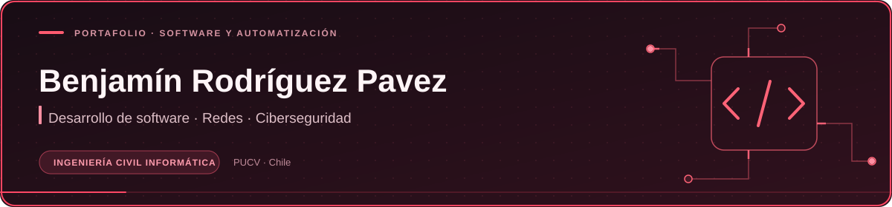

<strong>Estudiante de Ingeniería Civil Informática · PUCV</strong> Desarrollo de software · Automatización de redes · Ciberseguridad

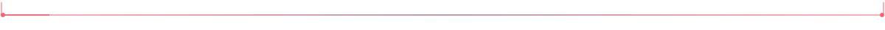

### Proyectos destacados

<table>
<tr>
<td width="50%"><a href="https://github.com/RodriguezPavezBenjamin/JembaTech"></a></td>
<td width="50%"><a href="https://github.com/RodriguezPavezBenjamin/JembaMD"></a></td>
</tr>
<tr>
<td width="50%"><a href="https://github.com/RodriguezPavezBenjamin/JembaRent"></a></td>
<td width="50%"><a href="https://github.com/RodriguezPavezBenjamin/panelServeMC"></a></td>
</tr>
</table>

**Otros proyectos:** [Kuromitz2](https://github.com/RodriguezPavezBenjamin/Kuromitz2), prototipo colaborativo de recomendaciones de películas y series con Ionic y Angular; y [Proyecto-GM-final](https://github.com/RodriguezPavezBenjamin/Proyecto-GM-final), videojuego académico en Java con libGDX.

### Tecnologías y conocimientos

<table>
<tr>
<td width="50%">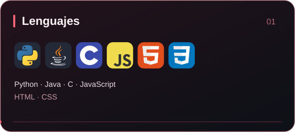</td>
<td width="50%">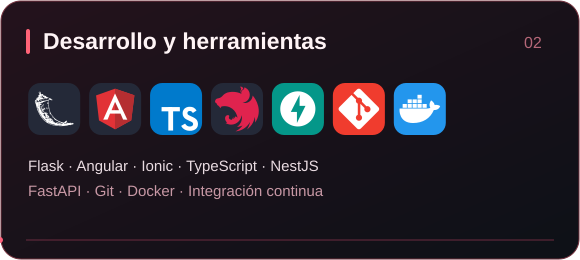</td>
</tr>
<tr>
<td width="50%">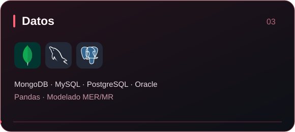</td>
<td width="50%">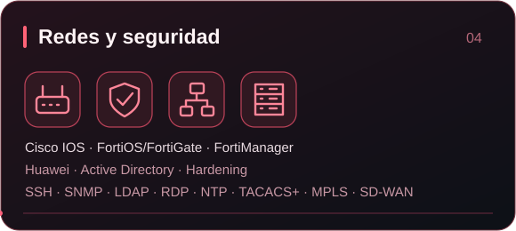</td>
</tr>
</table>

### Experiencia práctica

### Formación complementaria

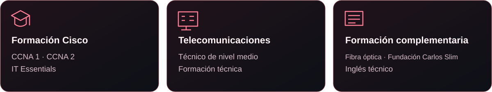

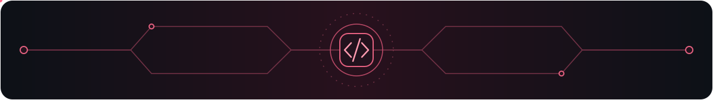

### Actividad en GitHub

